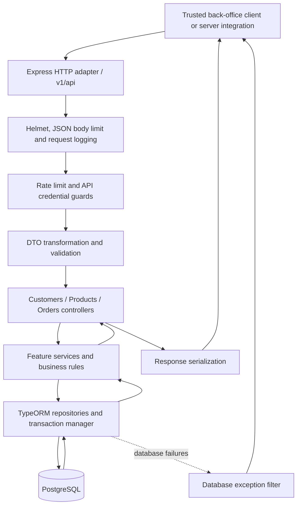
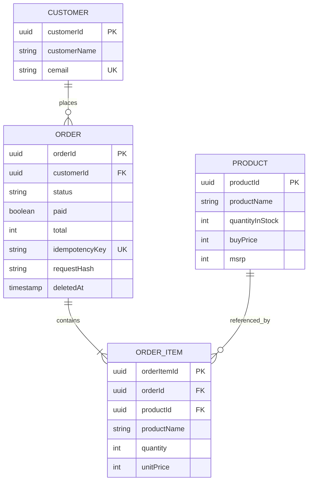
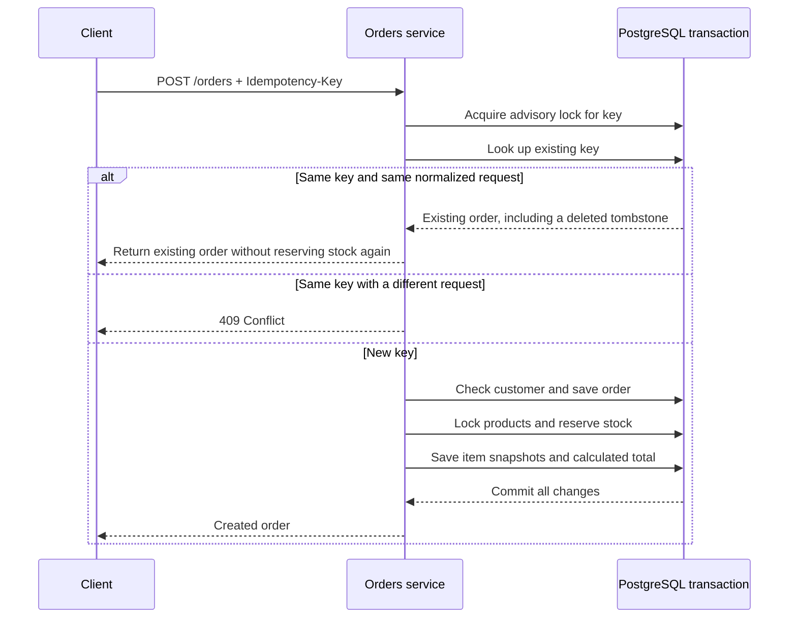
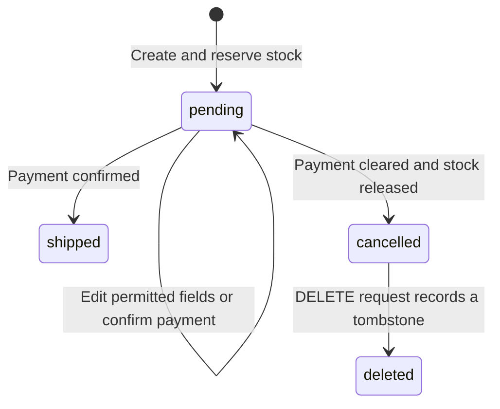

# 🛒 NestJS Shop API — Customers, Products & Orders

[](https://nodejs.org/)
[](https://www.typescriptlang.org/)
[](https://nestjs.com/)
[](https://typeorm.io/)
[](https://www.postgresql.org/)
[](https://www.docker.com/)
[](LICENSE)

A TypeScript commerce backend for managing **customers, products, inventory, and orders**.
Built with **NestJS**, **TypeORM**, and **PostgreSQL**, the project demonstrates how a CRUD API
can grow into a modular application with transactional order processing, safe retries, inventory
protection, validated contracts, and a reproducible container deployment. It partially implements
**Vertical Slice Architecture (VSA)** to a reasonable extent through feature-based modules, while
retaining controller, service, and repository layers within each feature.

Originally part of the **Stevaso Tech TypeScript End-to-End series, Part 6**, this repository also
serves as a practical reference for learning backend architecture and commerce domain concepts.

**Architecture & Development: Burhan Saadi**

> **Application boundary:** this API serves trusted back-office systems and server-side integrations.
> Its read/write keys grant application-wide access. A customer-facing application needs its own
> identity layer and customer ownership checks before calling this backend.

---

## 📐 Architecture & Flow

The application is a **modular monolith**: one deployable Node.js application, organized into
customer, product, and order feature modules, sharing a PostgreSQL database. Keeping these features
in one process makes it possible to update orders and inventory in a single database transaction.



### Responsibilities by layer

| Layer                     | Responsibility                                                                          | Where to look                                     |
| :------------------------ | :-------------------------------------------------------------------------------------- | :------------------------------------------------ |
| **Bootstrap**             | Create the app, register shared HTTP settings, bind the port, and enable shutdown hooks | [main.ts](src/main.ts), [setup.ts](src/setup.ts)  |
| **Composition**           | Wire feature modules, database configuration, guards, middleware, and filters           | [app.module.ts](src/app.module.ts)                |
| **Controllers**           | Define routes, accept validated input, and delegate work                                | `src/*/*.controller.ts`                           |
| **DTOs**                  | Define allowed input fields, data types, and validation rules                           | `src/*/dto/`                                      |
| **Services**              | Apply business rules and coordinate persistence                                         | [orders.service.ts](src/orders/orders.service.ts) |
| **Entities**              | Map records, relationships, timestamps, and constraints                                 | `src/*/entities/`                                 |
| **Database migrations**   | Apply explicit, versioned schema changes                                                | [database/](src/database/)                        |
| **Shared infrastructure** | Enforce credentials, pagination, logging, and database error translation                | [common/](src/common/)                            |

Controllers remain small; order consistency belongs in the service and database transaction.
NestJS dependency injection supplies repositories and the data source, making those dependencies
explicit and replaceable in tests.

### Data model



Each order contains 1–100 distinct products. The order-item record stores a snapshot of the product
name and selling price; later catalog edits do not rewrite existing order prices. Foreign keys
protect referenced customer and product records, including those referenced by retained order history.

---

## ✨ Key Features

- **🧩 Feature modules** — Separate customer, product, and order modules with controllers, services,
  DTOs, and entities.
- **🔒 Read/write access** — Separate API credentials for reading data and administering resources;
  health endpoints are public.
- **✅ Runtime validation** — DTO transformation, nested validation, UUID checks, bounded pagination,
  and rejection of unknown fields.
- **🔁 Retry-safe creation** — Idempotency keys prevent a repeated order request from reserving stock twice.
- **📦 Concurrent inventory protection** — Product row locks coordinate reservations and stock adjustments.
- **💰 Consistent money handling** — Integer minor units, server-calculated totals, and price snapshots.
- **🧾 Controlled order lifecycle** — Payment checks, cancellation with stock release, and soft deletion.
- **🐳 Containerized stack** — PostgreSQL readiness, a migration job, a non-root API container, and
  an optional k6 load-test profile.
- **🧪 Automated verification** — Unit and PostgreSQL integration tests, plus CI lint, type, build,
  and production dependency checks.

---

## 📂 Repository Structure

```text
backend_nest_p6/
├── src/
│   ├── main.ts                     # Application entry point
│   ├── setup.ts                    # Shared HTTP configuration
│   ├── app.module.ts               # Root composition module
│   ├── config.ts                   # Required variables, ports and API key checks
│   ├── health.controller.ts        # Liveness and database readiness
│   ├── customers/                  # Customer controllers, services, DTOs and entity
│   ├── products/                   # Catalog, prices and available inventory
│   ├── orders/                     # Transactional order processing and line items
│   ├── common/
│   │   ├── auth.guard.ts           # Read/write credential enforcement
│   │   ├── pagination.dto.ts       # Validated offset and limit
│   │   ├── filters/                # Safe database error responses
│   │   └── middleware/             # Structured HTTP completion logs
│   └── database/
│       ├── data-source.ts          # Shared TypeORM configuration
│       ├── cli.ts                  # Migration CLI data source
│       └── migrations/             # Versioned schema changes
├── test/
│   ├── app.e2e-spec.ts             # API integration tests against PostgreSQL
│   └── k6scripts/test.js           # Load-test checks and thresholds
├── .github/workflows/ci.yml        # Automated checks and isolated test database
├── .env.example                   # Environment variable template
├── Dockerfile                     # Build stage and non-root runtime stage
├── docker-compose.yml             # Database, migration, API and optional k6 services
├── rest-client.http               # Editable HTTP request examples
├── package.json                   # Dependencies and development commands
└── README.md                      # Project presentation and operating guide
```

Unit tests live beside their source files as `*.spec.ts`.

---

## 🧠 Architecture Concepts

### Transactions: one operation, one outcome

An order creation writes an order, reserves inventory, inserts its items, and calculates its total
inside one transaction. If any step fails, the database rolls back the operation. This avoids a
saved order with missing items or stock deducted for a failed request.

Order updates also use transactions. Related writes use the transaction's `EntityManager`, so they
participate in the same commit or rollback.

### Idempotency: retries without duplicate orders

Clients send an `Idempotency-Key` on `POST /orders`. The service hashes the normalized request and
uses a PostgreSQL transaction-scoped advisory lock to serialize requests with the same key.



The key must contain 8–128 ASCII letters, digits, underscores, or hyphens. Item ordering is
normalized for the fingerprint; comments and shipping date are included. Keys are retained even
after soft deletion. A retry returns the stored order's current state, rather than a cached copy
of its original HTTP response. Internal keys and hashes are excluded from API responses.

### Pessimistic locking: protect the last item in stock

Before adjusting stock, the service locks the relevant product rows using `pessimistic_write`.
Two concurrent orders for the last available unit must take turns: after one commits, the other
sees the remaining stock and receives a conflict if there is not enough. Product locks are acquired
in sorted ID order to reduce deadlock risk. Updates lock the order row before changing its contents.

### Integer money and historical snapshots

Prices use integer **minor units in one application currency**: `150` represents `1.50` for a
currency with two decimal places. Product `msrp` becomes the order item's `unitPrice` on first
insertion. The server calculates:

```text
order.total = sum(item.unitPrice × item.quantity)
```

Product prices and available stock are bounded from 0 to 100,000,000; quantities are positive
integers up to 100,000. An order total must fit a signed PostgreSQL integer. Currency conversion,
taxes, discounts, and shipping charges are outside the current calculation.

### DTOs and entities serve different purposes

A DTO defines what a caller may submit. An entity defines what the database stores. For example,
clients submit a product ID and quantity, while the server chooses item IDs, price snapshots,
initial status, initial payment state, and the total. TypeScript provides compile-time checks;
`ValidationPipe` supplies the runtime checks needed for untrusted JSON.

### State transitions and soft deletion



Only pending orders can change. Changing the items of a paid order requires clearing payment
confirmation, either beforehand or in the same update. Shipping requires confirmed payment and
sets a shipping date if none exists. Cancellation requires payment confirmation to be cleared and
releases stock once. Shipped and cancelled orders cannot reopen.

`deleted` is shown as a lifecycle step in the diagram; it is represented by `deletedAt`, not by
another `status` value. Deletion is allowed only after cancellation. It hides the order from normal
reads while retaining its history and retry key. The `paid` flag is a back-office confirmation;
this project does not process payments or refunds through a payment provider.

---

## 🚀 Getting Started

### Prerequisites

- **Docker with Compose** for the bundled stack.
- **Node.js 24 LTS and npm** for development outside Docker.
- **PostgreSQL 17** reachable from your machine for a native development run.
- Two distinct random API credentials, each at least 32 characters long.

### Configure the environment

Copy the template in PowerShell:

```powershell
Copy-Item .env.example .env
```

On Linux or macOS, use `cp .env.example .env`.

Generate a key with the following command, run it twice, and set `API_READ_KEY` and `API_WRITE_KEY`
to different results. Replace the database password as well.

```bash
node -e "console.log(require('crypto').randomBytes(32).toString('hex'))"
```

Keep `.env` private. The placeholder values are examples, not deployment credentials.

### Local development setup

Install the locked dependencies:

```bash
npm ci
```

Set `DB_HOST`, `DB_PORT`, and the other database variables in `.env` to match a reachable local
PostgreSQL instance with an empty application database. Apply migrations, then start watch mode:

```bash
node --env-file=.env -r ts-node/register ./node_modules/typeorm/cli.js migration:run -d ./src/database/cli.ts
node --env-file=.env ./node_modules/@nestjs/cli/bin/nest.js start --watch
```

These commands load `.env` explicitly. If your shell already contains the variables, use
`npm run migration:run` and `npm run start:dev` instead. The npm scripts do not automatically load
`.env`. The Compose database is private to the container network and has no published host port.

The API base URL is **`http://localhost:3000/v1/api`** when using the default port.

---

## 🐳 Docker Deployment

With `.env` configured, run:

```bash
docker compose up --build
```

The stack starts in this order:

```text
PostgreSQL becomes healthy → migration job succeeds → backend API starts
```

| Service      | Purpose                                                      |
| :----------- | :----------------------------------------------------------- |
| `postgres`   | PostgreSQL 17 with persistent storage in `postgres_data`     |
| `migrate`    | One-shot execution of compiled TypeORM migrations            |
| `backendapi` | API exposed at `127.0.0.1:3000` on the host                  |
| `k6`         | Optional load-test runner enabled through the `load` profile |

Compose overrides `DB_HOST=postgres` and `DB_PORT=5432` for the migration and API containers.
Keep `PORT=3000` for this stack: the published port and container readiness check target port 3000.
The multi-stage image installs from the lockfile, compiles TypeScript, removes development
dependencies, and runs the application as the non-root `node` user.

To stop the stack while keeping database data:

```bash
docker compose down
```

---

## 🔑 Configuration

| Variable        | Required? | Default  | Purpose                                                          |
| :-------------- | :-------- | :------- | :--------------------------------------------------------------- |
| `DB_HOST`       | Yes       | None     | PostgreSQL hostname; Compose overrides it to `postgres`          |
| `DB_PORT`       | No        | `5432`   | PostgreSQL port                                                  |
| `DB_USER`       | Yes       | None     | Database username                                                |
| `DB_PASSWORD`   | Yes       | None     | Database password                                                |
| `DB_NAME`       | Yes       | None     | Application database name                                        |
| `DB_SSL`        | No        | Disabled | Set exactly `true` to enable certificate-verified PostgreSQL TLS |
| `PORT`          | No        | `3000`   | HTTP listening port; keep 3000 for the supplied Compose stack    |
| `API_READ_KEY`  | Yes       | None     | Application-wide read access through `x-api-key`                 |
| `API_WRITE_KEY` | Yes       | None     | Application-wide administrative access through `x-api-key`       |

Required values, ports, and key length/distinctness are checked during initialization. Compose
reads `.env`; native Node/CLI commands need variables in the shell or the explicit `--env-file`
commands above. For a remote database, enable TLS and configure trusted CAs through the Node runtime
when necessary.

### Access model

| Credential | Allowed operations                                           |
| :--------- | :----------------------------------------------------------- |
| No key     | Public health endpoints only                                 |
| Read key   | Protected `GET` and `HEAD` requests                          |
| Write key  | Reads and administrative create, update, and delete requests |

Keys identify trusted integrations and must remain server-side. They do not identify individual
customers or implement tenant isolation. Do not embed them in browser or mobile applications.

---

## 🛍️ API Reference & Examples

All routes below are relative to `/v1/api`. Supply `x-api-key` except on the two health endpoints.

| Method                   | Route            | Purpose                                                              |
| :----------------------- | :--------------- | :------------------------------------------------------------------- |
| `GET`                    | `/health/live`   | Process liveness                                                     |
| `GET`                    | `/health/ready`  | Database connectivity check                                          |
| `GET`, `POST`            | `/customers`     | List or create customers                                             |
| `GET`, `PATCH`, `DELETE` | `/customers/:id` | Read, update, or delete a customer                                   |
| `GET`, `POST`            | `/products`      | List or create products                                              |
| `GET`, `PATCH`, `DELETE` | `/products/:id`  | Read, update, or delete a product                                    |
| `GET`, `POST`            | `/orders`        | List summaries or create an order                                    |
| `GET`, `PATCH`, `DELETE` | `/orders/:id`    | Read items, update a pending order, or soft-delete a cancelled order |

### Create a customer and product

Use a write credential. Replace the key placeholders before sending these requests:

```http
POST http://localhost:3000/v1/api/customers
x-api-key: YOUR_WRITE_KEY
Content-Type: application/json

{
  "customerName": "Burhan Saadi",
  "cemail": "burhan@example.com",
  "phone": "+923001234567",
  "address": "1 Example Street",
  "city": "Karachi",
  "postalCode": "74000",
  "country": "PK"
}
```

```http
POST http://localhost:3000/v1/api/products
x-api-key: YOUR_WRITE_KEY
Content-Type: application/json

{
  "productName": "Wireless Headphones",
  "productvendor": "Example Vendor",
  "productDescription": "Example catalog item",
  "quantityInStock": 10,
  "buyPrice": 10000,
  "msrp": 15000
}
```

Keep the generated `customerId` and `productId` from the responses. No customer or catalog seed
data is loaded automatically. Field names such as `cemail` and `productvendor` match the current API.

### Place an order

Replace the two ID placeholders with the generated UUIDs:

```http
POST http://localhost:3000/v1/api/orders
x-api-key: YOUR_WRITE_KEY
Idempotency-Key: example-order-001
Content-Type: application/json

{
  "customerId": "CUSTOMER_UUID",
  "comments": "Example order",
  "orderItems": [
    { "productId": "PRODUCT_UUID", "quantity": 2 }
  ]
}
```

With the example product, the server calculates `total: 30000` and reserves two units. Resending
the same request with the same key returns that order without another reservation. Use a new key
for a new order. The create request also accepts an optional `shippingDate`.

### Update an order

```http
PATCH http://localhost:3000/v1/api/orders/ORDER_UUID
x-api-key: YOUR_WRITE_KEY
Content-Type: application/json

{ "comments": "Updated delivery instructions" }
```

An omitted `orderItems` array leaves items unchanged. A supplied array **replaces the complete
item list**, using product IDs and quantities; it must contain 1–100 distinct products. Existing
products retain their price snapshots. Item IDs and client-supplied totals or prices are rejected.

After external payment confirmation, an administrator can submit `{"paid": true, "status": "shipped"}`.
To cancel an unshipped order, submit `{"paid": false, "status": "cancelled"}` after any required
external refund is confirmed. Optional update fields reject `null`.

### Paginated reads

```http
GET http://localhost:3000/v1/api/products?offset=0&limit=20
x-api-key: YOUR_READ_KEY
```

Lists return `{ "items": [...], "total": 42, "offset": 0, "limit": 20 }` in a stable order.
The limit is 1–100, with a default of 20; offset is 0–100,000. Order lists omit items, while an
individual order read includes them. Product/customer PATCH accepts an empty body object as a read
of the current resource. Repeated deletion returns 404.

See [rest-client.http](rest-client.http) for editable requests.

---

## 🧪 Testing & Verification

### Local checks

```bash
npm run lint
npm run typecheck
npm run build
npm test -- --runInBand
npm run test:cov
npm audit --omit=dev
```

### PostgreSQL integration tests

Use a **dedicated disposable database** whose name ends in `_test`. The suite applies migrations
and truncates application tables; never point it at application data. Set its database connection
variables in the shell and run:

```bash
npm run test:e2e -- --runInBand
```

Alternatively, put the test connection variables in the ignored `.env.test.local` file and run:

```bash
node --env-file=.env.test.local ./node_modules/jest/bin/jest.js --config ./test/jest-e2e.json --runInBand
```

The suite supplies its own test API credentials. Tests cover authentication, concurrent idempotent
retries, rollback, partial updates, cancellation, soft deletion, foreign-key protection, payment
confirmation rules, and concurrent overselling prevention. The [CI workflow](.github/workflows/ci.yml)
provisions an isolated PostgreSQL database and runs the production audit, lint, type checks, build,
unit tests, and integration tests.

### Load-test smoke check

With the Docker stack configured, run:

```bash
docker compose --profile load run --rm k6
```

The [k6 script](test/k6scripts/test.js) runs one virtual user for three minutes against the paginated
customer endpoint. Its thresholds require less than 1% failed HTTP requests, a p95 request duration
below 200 ms, and more than 99% passing checks. These are test thresholds, not a guaranteed service
level. Increase load and adjust rate limits together when performing capacity testing.

---

## 🗃️ Migrations & Existing Databases

Schema synchronization is disabled in every environment. The initial migration targets an
**empty database** and fails if legacy application tables already exist. Do not delete an existing
volume or re-enable synchronization to bypass that failure.

For a new schema change, write and review a TypeORM migration, register it in
[databaseOptions().migrations](src/database/data-source.ts), and run migrations once before deploying
application replicas. The migration CLI entry point is [cli.ts](src/database/cli.ts).

The original tutorial schema requires a separate data-upgrade plan:

1. Back up the original database and verify restoration; keep the original data intact.
2. Provision a new database and apply the current schema.
3. Reconcile floating-point prices into agreed integer minor units and declare timestamp timezone assumptions.
4. Reconcile historical line prices, payment confirmations, and stock balances. Legacy items lack
   historical unit prices, so those values cannot safely be invented from today's catalog.
5. Import through a reviewed migration with unique retry keys, then validate counts, totals,
   foreign keys, and inventory before cutover.

The initial migration deliberately disables destructive rollback. Restore a verified backup or
apply a reviewed forward migration when recovery is needed.

---

## 🚢 Production Notes

- **Security boundary** — Put the API behind HTTP TLS and a trusted reverse proxy. Keep integration
  keys in a secret store, restrict network access, and add user ownership checks in any customer-facing layer.
- **Input protection** — Requests are limited to 128 KiB of uncompressed JSON. Helmet headers,
  runtime validation, unknown-field rejection, and UUID route validation are enabled.
- **Rate limiting** — The default Nest throttler limit is 120 requests per minute per IP and route,
  tracked within each process. Use distributed ingress limits before scaling across replicas.
  Proxy trust is disabled; configure it only for known proxy addresses.
- **Observability** — HTTP completion logs include a server-generated request ID, method, path,
  status, and duration. Bodies and credentials are omitted. Export stdout to your monitoring platform
  and alert on latency, error rates, and readiness failures.
- **Database operations** — Each application pool is capped at 10 connections, with a 5-second
  connection timeout, 10-second lock timeout, and 15-second statement timeout. Size total connections
  across replicas against database capacity. Schedule backups and exercise restoration.
- **Health and shutdown** — Use `/v1/api/health/live` for liveness and `/v1/api/health/ready` for
  database connectivity. Nest shutdown hooks are enabled. Readiness is not a schema-drift check.
- **Dependencies** — Install using the committed lockfile. Scoped Multer and modern glob/minimatch
  overrides address advisories while preserving older tooling APIs; reassess them on upgrades.
- **Current scope** — Single application currency, manual payment confirmation, and trusted
  integration credentials. Payment-provider settlement, refunds, taxes, discounts, customer login,
  tenant isolation, and complete actor-level audit trails require further implementation.

At the November 2026 verification, the production dependency audit reported **zero vulnerabilities**.
The full audit reported **nine low-severity development-tool findings** stemming from `deepmerge`
through Jest and the Nest CLI, with no compatible patched release available. Those development
tools are removed from the runtime image. Recheck advisories regularly; do not blindly apply npm's
suggested major-version downgrades.

---

## 🧯 HTTP Errors & Troubleshooting

| Status / symptom                                    | Meaning                                                                 | What to check                                                                     |
| :-------------------------------------------------- | :---------------------------------------------------------------------- | :-------------------------------------------------------------------------------- |
| `400 Bad Request`                                   | Invalid DTO, UUID, pagination, idempotency header, or database input    | Field names, types, bounds, and unknown fields                                    |
| `401 Unauthorized`                                  | Missing or invalid API credential                                       | Send the correct `x-api-key`                                                      |
| `403 Forbidden`                                     | Read credential used for a write                                        | Use the administrative credential in a trusted server                             |
| `404 Not Found`                                     | Resource does not exist or an order is soft-deleted                     | Resource ID and order lifecycle                                                   |
| `409 Conflict`                                      | Stock, state, retry-key, uniqueness, reference, or concurrency conflict | Resolve the business conflict; retry transient concurrency failures appropriately |
| `413 Payload Too Large`                             | Body exceeds the configured limit                                       | Keep JSON under 128 KiB                                                           |
| `415 Unsupported Media Type`                        | Compressed JSON is rejected                                             | Send uncompressed JSON                                                            |
| `429 Too Many Requests`                             | Throttler limit exceeded                                                | Reduce the request rate                                                           |
| `500 Internal Server Error`                         | Unexpected application or database failure                              | Server logs and database availability                                             |
| `503 Service Unavailable` on readiness              | Database connectivity check failed                                      | Database health, credentials, and network                                         |
| Startup reports a required variable or invalid keys | Configuration failed validation                                         | Environment loading, distinct keys, key length, and valid ports                   |
| Migration reports existing tables                   | Initial migration encountered a legacy/unbaselined schema               | Follow the existing-database upgrade plan                                         |

Database exceptions return safe messages rather than raw SQL or driver details. Response formats
can differ between validation, HTTP, and database exceptions; there is no universal error-code envelope.

---

## 👨‍💻 Author & Project Background

**Burhan Saadi — Architecture & Development**

Created as part of the **Stevaso Tech TypeScript End-to-End series, Part 6**, covering REST APIs
with NestJS, TypeORM, and PostgreSQL. The project illustrates feature-based modular design,
dependency injection, DTO validation, relational modeling, transactions, concurrency control,
idempotency, and container-based development.

Compared with the tutorial's original CRUD contracts, the current API adds authenticated access,
paginated lists, integer money, server-owned order fields, required idempotency headers, replacement
item updates by product ID, controlled status transitions, and soft deletion. Existing clients must
adapt to these contracts.

---

## 📄 License

Copyright (c) 2024 **Burhan Saadi**. Licensed under the [MIT License](LICENSE).

You may use, modify, distribute, sublicense, and sell copies of this software, provided that the
copyright and permission notices are included in all copies or substantial portions. The software
is provided **"as is"**, without warranty. Dependency licenses remain their respective authors' terms.
